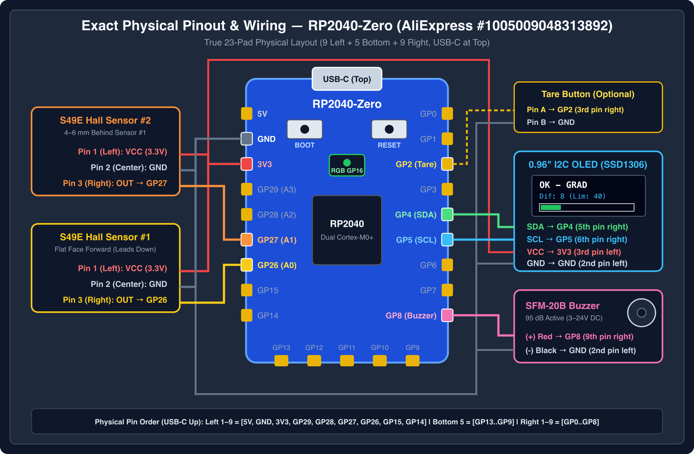
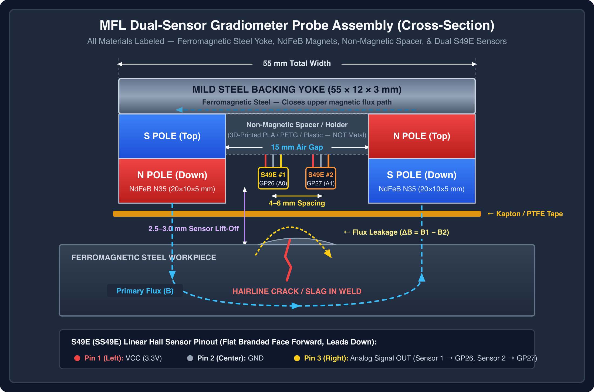

# OpenNDT Weld Inspector (`open-ndt-weld`)

Open-source, low-cost, portable Non-Destructive Testing (NDT / END) alternatives to industrial X-Ray weld inspection, organized into two hardware tiers:

- **Tier 1 (Immediate / Ultra-Low-Cost):** Differential Magnetic Flux Leakage (MFL) / Gradiometer detector using an **RP2040-Zero** microcontroller and **dual linear Hall sensors (SS49E)** for ferromagnetic metals (Carbon Steel, Iron, 400-series Stainless).
- **Tier 2 (Advanced / Multi-Material):** High-Frequency Eddy Current Testing (ET) system using a **Sipeed Tang Nano 9K FPGA** (Gowin GW1NR-9) for non-ferromagnetic and ferromagnetic metals (Aluminum, 304/316 Stainless Steel, Copper, Steel).

---

## Repository Structure

```text
Grietas/
├── README.md                              # Project specification & executive blueprint
├── docs/
│   └── HARDWARE_AND_ASSEMBLY.md           # Probe construction, 4-zone specimen, AFE & calibration guide
├── tier1-mfl-rp2040/                      # Subsystem 1: RP2040-Zero Differential MFL Gradiometer
│   ├── platformio.ini                     # PlatformIO build configuration
│   ├── src/
│   │   └── main.cpp                       # Differential Gradiometer C++ firmware (PlatformIO)
│   └── mfl_inspector/
│       └── mfl_inspector.ino              # Arduino IDE compatible sketch
└── tier2-et-tangnano9k/                   # Subsystem 2: Tang Nano 9K FPGA Eddy Current DSP
    ├── Makefile                           # Open-source FPGA toolchain build (Yosys/nextpnr)
    ├── constraints/
    │   └── tangnano9k.cst                 # Physical pin constraints for Tang Nano 9K
    └── src/
        ├── top.v                          # Top-level FPGA pipeline integration
        ├── nco_100khz.v                   # 100 kHz NCO drive & quadrature sin/cos LUT
        ├── spi_adc_reader.v               # 12-bit 1 MSPS SPI ADC interface (ADS7883/ADC121S101)
        └── iq_demodulator.v               # Digital Lock-In I/Q demodulator & LPF
```

---

## 1. Hardware Stack & Bill of Materials (BOM)

### Tier 1: MFL Gradiometer Detector (RP2040-Zero Core)

| Component | Purchased Part / Model | Qty | Actual Cost | Function & Order Link |
| :--- | :--- | :---: | :---: | :--- |
| **Microcontroller** | **RP2040-Zero** (Raspberry Pi PICO Dual-Core M0+) | 1 | ~€2.59 | 32-bit ARM Cortex-M0+, 12-bit ADC, USB-C, On-board NeoPixel (`GP16`) — [AliExpress `1005009048313892`](https://de.aliexpress.com/item/1005009048313892.html) |
| **Sensors** | **S49E (SS49E)** Linear Hall Sensors (10-pack) | 2 (of 10) | ~€2.15 (€0.22/pc) | Dual-sensor differential gradiometer layout (lift-off / noise cancellation) — [AliExpress `1005006061649001`](https://de.aliexpress.com/item/1005006061649001.html) |
| **Excitation Magnets** | **NdFeB N35 Block Magnets** ($20 \times 10 \times 5\text{ mm}$) | 2 to 4 | ~€2.89 (2pcs) | Injects magnetic flux into the workpiece (can be stacked 2x per pole) — [AliExpress `1005013216759299`](https://de.aliexpress.com/item/1005013216759299.html) |
| **Magnetic Yoke** | Mild Steel / Iron Plate ($55 \times 12 \times 3\text{ mm}$) | 1 | Scrap | Backing plate to close the magnetic flux circuit ("U" shape) |
| **Display** | **0.96" I2C OLED SSD1306** ($128 \times 64$, 4-pin IIC) | 1 | ~€1.81 | Real-time graphical UI (Bar graph, status, gradient values, threshold) — [AliExpress `1005006141235306`](https://de.aliexpress.com/item/1005006141235306.html) |
| **Acoustic Alert** | **SFM-20B Active Piezo Buzzer** (DC 3–24V, 95 dB) | 1 (of 5) | ~€2.26 (5pcs) | High-decibel continuous beep alarm on defect detection — [AliExpress `1005012810667051`](https://de.aliexpress.com/item/1005012810667051.html) |
| **Input** | Tactile Pushbutton (or `GP2` to `GND` / `RESET`) | 1 | ~€0.20 | Calibration / Tare trigger (note: pressing RP2040-Zero `RESET` also re-runs `calibrar()` on boot) |
| **Power** | Standard 5V Powerbank / USB-C | 1 | Existing | Portable power supply |

### Tier 2: Eddy Current System (Tang Nano 9K FPGA Upgrade)

| Component | Part / Model | Qty | Function |
| :--- | :--- | :---: | :--- |
| **FPGA Board** | Sipeed Tang Nano 9K (GW1NR-9) | 1 | High-speed DSP, NCO, I/Q Demodulation, HDMI Output |
| **AFE OpAmp** | MCP6002 / AD8052 / TL072 | 1 | Signal amplification ($A_v \approx 22$) and $1.65\text{ V}$ DC offset bias |
| **ADC** | ADS7883 / ADC121S101 | 1 | 12-bit SPI ADC ($1\text{ to }3\text{ MSPS}$) |
| **Resonant Cap $C_1$** | 10 nF to 47 nF Poly/Ceramic (NP0/C0G) | 1 | Forms parallel LC tank circuit tuned to $f_r \approx 100\text{ kHz}$ |
| **ET Probe Coil** | ~70 turns 32 AWG on 5 mm ferrite core | 1 | High-frequency electromagnetic probe with electrostatic foil shield |

---

## 2. Subsystem 1: Differential Magnetic Flux Leakage (MFL) — RP2040-Zero

### 2.1 Physics & Differential Gradiometer Principle
When permanent magnets induce a magnetic field $B$ within a ferromagnetic plate:
1. In a homogeneous weld (sound metal), magnetic flux lines flow unobstructed inside the material.
2. If a surface crack or near-surface discontinuity is present, magnetic permeability drops, forcing flux to leak into the surrounding air ($B_{\text{leakage}}$).
3. **Differential Gradiometer Layout:** Using two SS49E sensors placed close together (Axial layout 4–6 mm apart along the scan line, or Vertical layout stacked 4 mm apart):

$$\Delta B = B_{\text{Sensor1}} - B_{\text{Sensor2}}$$

4. Common-mode noise (hand wobble, lift-off, uneven weld bead height, background magnetic drift) affects both sensors equally and cancels out to zero ($\Delta B \approx 0$). Localized defects produce a sharp gradient peak.

### 2.2 Pin Mapping & Wiring Schematic (RP2040-Zero)


*Vector Reference: [rp2040_wiring_schematic_vector.svg](docs/images/rp2040_wiring_schematic_vector.svg) | Rendered Illustration: [rp2040_wiring_schematic.jpg](docs/images/rp2040_wiring_schematic.jpg)*

```text
RP2040-Zero Pinout Configuration:
├── GP26 (A0)  <--- SS49E Sensor 1 Signal Output (Pin 3 OUT)
├── GP27 (A1)  <--- SS49E Sensor 2 Signal Output (Pin 3 OUT)
├── GP2        <--- Calibration Pushbutton (Active LOW, internal pull-up)
├── GP8        <--- Active Buzzer Positive (+)
├── GP4        <--- OLED I2C SDA
├── GP5        <--- OLED I2C SCL
├── GP16       <--- On-board WS2812 NeoPixel RGB LED
├── 3V3        <--- VCC Power (SS49E VCC, OLED VCC)
└── GND        <--- Common Ground (SS49E GND, Pushbutton, Buzzer, OLED)
```

---

## 3. Subsystem 2: High-Frequency Eddy Current (ET) — Tang Nano 9K FPGA

### 3.1 Physics & Mathematics
Eddy current testing works on electromagnetic induction:
- The probe coil is driven at high frequency ($f_r \approx 100\text{ kHz}$).
- The primary magnetic field induces circular eddy currents $I_{\text{eddy}}$ within conductive materials (Aluminum, Stainless 304/316).
- The resonant frequency of the parallel LC tank is given by:

$$f_r = \frac{1}{2\pi \sqrt{L C_1}}$$

- A crack disrupts $I_{\text{eddy}}$, altering complex impedance $\mathbf{Z} = R + j\omega L$.

### 3.2 FPGA Processing Pipeline (Verilog Architecture)

```text
 +-------------------------------------------------------------------------+
 |                      Tang Nano 9K FPGA Architecture                     |
 |                                                                         |
 |  +---------------+     100 kHz PWM     +-----------------------------+  |
 |  | NCO / Clock   |-------------------->| Drive Pin -> LC Tank Probe  |  |
 |  | Generator     |                     +-----------------------------+  |
 |  +---------------+                                  |                   |
 |          | Sine / Cosine Reference                  v                   |
 |          v                                 +-----------------+          |
 |  +---------------+     SPI Data (1 MSPS)   | Analog Front    |          |
 |  | IQ Lock-In    |<------------------------| End + SPI ADC   |          |
 |  | Demodulator   |                         +-----------------+          |
 |  +---------------+                                                      |
 |          |                                                              |
 |          v                                                              |
 |  +---------------+     Phase/Mag           +-----------------+          |
 |  | Moving Average|------------------------>| HDMI Controller |          |
 |  | Filter (LPF)  |                         | Display Output  |          |
 |  +---------------+                         +-----------------+          |
 +-------------------------------------------------------------------------+
```

---

## 4. Mechanical Construction & Probe Specifications

### 4.1 Dual-Sensor Gradiometer MFL Probe Blueprint


*Vector Reference: [mfl_probe_build_vector.svg](docs/images/mfl_probe_build_vector.svg)*

```text
         +---------------------------------------------------+
         |          Mild Steel Backing Yoke (55x12x3mm)      |
         +---------------------------------------------------+
             |                                           |
     +---------------+                           +---------------+
     | Magnet 1 (N)  |                           | Magnet 2 (S)  |
     | (20x10x5 mm)  |   <---- 15 mm Gap ---->   | (20x10x5 mm)  |
     +---------------+                           +---------------+
             |           +---------+ +---------+         |
             v           | Sensor1 | | Sensor2 |         v
     ====================| (GP26)  | | (GP27)  |======================  <-- Weld Surface
                         +---------+ +---------+
                              <-- 4-6 mm -->
                              Clearance: 2.5–3.0 mm (Kapton/Teflon Tape)
```

### 4.2 4-Zone Calibration Standard (Specimen Spec)
To map thresholds (`umbral`) for different defect classes:
- **Zone 1 (0–7 cm): Sound Reference Weld.** High quality, clean bead used for pressing Tare (`GP2`).
- **Zone 2 (7–14 cm): Lack of Fusion / Root Defect.** Reduced heat input with wire spacer in root gap, capped over.
- **Zone 3 (14–21 cm): Slag Inclusion.** SMAW E6013 pass over unchipped slag to encapsulate non-magnetic silicates (1–3 mm depth).
- **Zone 4 (21–28 cm): Surface/Sub-surface Crack.** Copper-induced hot cracking or fine 0.8 mm mechanical saw cut capped over.

### 4.3 Material & Defect Detection Capabilities

| Inspection Technique | Crack (Surface) | Lack of Fusion | Slag (Sub-surface <3mm) | Deep Slag (>4mm) | Material Compatibility |
| :--- | :---: | :---: | :---: | :---: | :--- |
| **MFL Single Sensor** | High | Moderate | Moderate | Low | Ferromagnetic Steel, 400-SS |
| **MFL Gradiometer (Dual)** | Very High | High | Moderate-High | Low | Ferromagnetic Steel, 400-SS |
| **Eddy Current (FPGA)** | High | High | High | Moderate | Aluminum, 304/316 SS, Steel |
| **Ultrasonic (UT FPGA)** | High | High | High | High | All Metals |

---

## 5. Execution & Troubleshooting Guidelines

1. **Gradiometer Calibration Protocol:** Always place the dual-sensor probe on the sound weld section (**Zone 1**) before hitting the calibration button (`GP2`).
2. **Lift-Off Management:** Keep sensor clearance at **2.5–3.0 mm** above the weld crown to attenuate micro-surface roughness without losing subsurface defect sensitivity.
3. **Sensor Polarity & Balance:** Both SS49E sensors must face the exact same direction (flat face forward).
4. **ADC Resolution:** Always ensure `analogReadResolution(12)` is called for RP2040 targets to use the full 12-bit range (`0`–`4095`).
