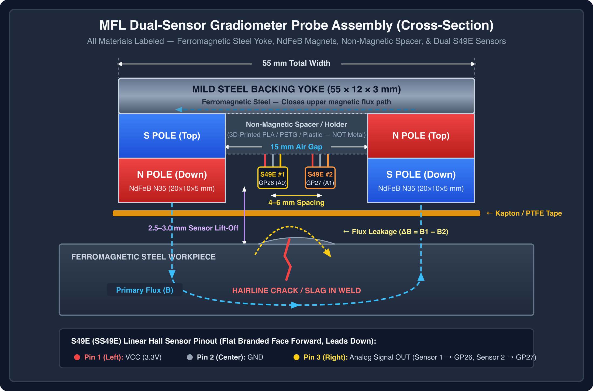
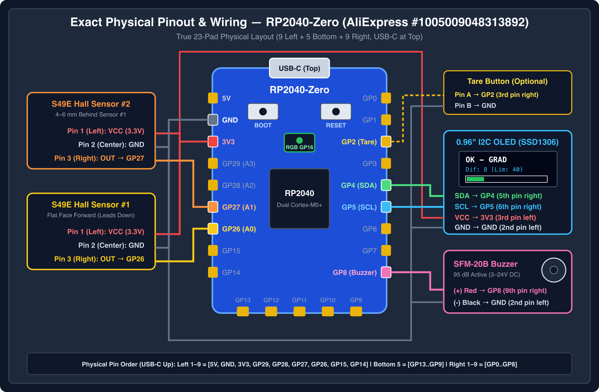

# Hardware, Probe Assembly & Calibration Specimen Guide

## 1. Tier 1: Dual-Sensor MFL Gradiometer Probe Assembly


*High-precision vector version: [mfl_probe_build_vector.svg](images/mfl_probe_build_vector.svg)*

### 1.1 Magnetic Bridge & Gradiometer Geometry
- **Backing Yoke:** Mild steel bar ($55 \times 12 \times 3\text{ mm}$).
- **Excitation Magnets:** 2 to 4 NdFeB N35/N52 magnets ($20 \times 10 \times 5\text{ mm}$) attached to opposite ends of the steel yoke with **opposite polarity** facing downward (can be stacked $2\times$ per pole for deeper magnetic flux penetration):
  - Left pole: **North (N)** facing the weld surface.
  - Right pole: **South (S)** facing the weld surface.
- **Inter-Magnet Gap:** $15\text{ mm}$ between the inner edges of the two magnet poles.
- **Dual Hall Sensor Placement (Gradiometer):**
  - Mount two **SS49E** linear Hall sensors (`Sensor 1 -> GP26`, `Sensor 2 -> GP27`) in the central gap between the magnets.
  - **Axial Layout:** $4\text{–}6\text{ mm}$ apart along the scan line (or **Vertical Layout** stacked $4\text{ mm}$ apart).
  - **Orientation:** Both SS49E sensors must face the exact same direction (flat face forward) so common-mode magnetic fields produce identical polarity voltages.
  - **Lift-Off Clearance:** Recess the sensors $2.5\text{–}3.0\text{ mm}$ above the weld crown and protect the base with Kapton or Teflon (PTFE) tape to attenuate micro-surface roughness and mechanical friction.
  - **3D-Printable Housing:** Print [mfl_gradiometer_housing.scad](../hardware/mfl_gradiometer_housing.scad) in **PLA, PETG, or ABS** (non-magnetic, 0.2 mm layer height, 25%+ infill). It holds the $55 \times 12 \times 3\text{ mm}$ yoke, both $20 \times 10 \times 5\text{ mm}$ magnets at a $15\text{ mm}$ gap, and both S49E sensors flat-face down at $5.0\text{ mm}$ spacing and $2.7\text{ mm}$ lift-off.

### 1.1.1 Wiring Schematic & Notes for Your Purchased Components


*High-precision vector version: [rp2040_wiring_schematic_vector.svg](images/rp2040_wiring_schematic_vector.svg) | Rendered Illustration: [rp2040_wiring_schematic.jpg](images/rp2040_wiring_schematic.jpg)*

- **RP2040-Zero ([`1005009048313892`](https://de.aliexpress.com/item/1005009048313892.html)):**
  - Powered via USB-C. Use the `3V3` pin to power both **S49E** sensors and the **0.96" OLED** so the analog output range matches the RP2040 ADC's $0\text{–}3.3\text{ V}$ reference.
  - Because `setup()` runs `calibrar()` automatically on startup, you can also trigger a fresh Tare calibration at any time using the RP2040-Zero's on-board **RESET** button even if you do not wire an external pushbutton to `GP2`.
- **10× S49E Linear Hall Sensors ([`1005006061649001`](https://de.aliexpress.com/item/1005006061649001.html)):**
  - Looking at the flat face with the `49E` marking and leads pointing down (left to right):
    1. **Pin 1 (Left):** `VCC` ($3.3\text{ V}$)
    2. **Pin 2 (Center):** `GND`
    3. **Pin 3 (Right):** `OUT` (Linear analog output: Sensor 1 $\rightarrow$ `GP26`, Sensor 2 $\rightarrow$ `GP27`)
- **SFM-20B 95 dB Active Piezo Buzzer ([`1005012810667051`](https://de.aliexpress.com/item/1005012810667051.html)):**
  - Rated for **DC 3–24V** continuous tone. Connect the red wire (`+`) directly to `GP8` and the black wire (`-`) to `GND` (draws $<12\text{ mA}$ at $3.3\text{ V}$, safe for direct RP2040 GPIO drive).
- **0.96" I2C SSD1306 OLED ([`1005006141235306`](https://de.aliexpress.com/item/1005006141235306.html)):**
  - 4-pin IIC module (`GND` $\rightarrow$ `GND`, `VCC` $\rightarrow$ `3V3`, `SCL`/`SCK` $\rightarrow$ `GP5`, `SDA` $\rightarrow$ `GP4`, default I2C address `0x3C`).
- **20×10×5 mm N35 NdFeB Block Magnets ([`1005013216759299`](https://de.aliexpress.com/item/1005013216759299.html)):**
  - Magnetized through the $5\text{ mm}$ thickness. Use a spare S49E sensor or compass before gluing to verify that one magnet has its **North** pole facing the workpiece and the other has its **South** pole facing the workpiece.

### 1.2 4-Zone Calibration Standard (Reference Specimen)
Fabricate a $28\text{ cm}$ test weld plate divided into four $7\text{ cm}$ zones to calibrate and verify detection thresholds (`umbral`):

```text
+-----------------+-----------------+-----------------+-----------------+
|   ZONE 1        |   ZONE 2        |   ZONE 3        |   ZONE 4        |
|   0 - 7 cm      |   7 - 14 cm     |   14 - 21 cm    |   21 - 28 cm    |
|   Sound Weld    |   Lack of       |   Slag          |   Surface /     |
|   (TARE REF)    |   Fusion / Root |   Inclusion     |   Sub-surface   |
|                 |   Defect        |   (1-3 mm deep) |   Crack (0.8mm) |
+-----------------+-----------------+-----------------+-----------------+
```

1. **Zone 1 (0–7 cm) — Sound Reference Weld:** High-quality, homogeneous bead. Place the probe here and press **Calibration (`GP2`)** to zero `offsetDiferencial`.
2. **Zone 2 (7–14 cm) — Lack of Fusion / Root Defect:** Welded with reduced heat input and a wire spacer in the root gap, then capped over.
3. **Zone 3 (14–21 cm) — Slag Inclusion:** SMAW E6013 pass laid over unchipped slag to encapsulate non-magnetic silicates at $1\text{–}3\text{ mm}$ depth.
4. **Zone 4 (21–28 cm) — Surface/Sub-surface Crack:** Copper-induced hot crack or a fine $0.8\text{ mm}$ mechanical saw cut capped over.

---

## 2. Tier 2: Eddy Current Probe & Analog Front-End (AFE)

### 2.1 Probe Coil & LC Tank Calculation
- **Ferrite Core:** $5\text{ mm}$ diameter cylindrical ferrite rod (e.g., MnZn or NiZn).
- **Winding:** $\sim 70\text{ turns}$ of $32\text{ AWG}$ enameled copper wire ($L \approx 55\text{–}250\text{ }\mu\text{H}$ depending on core permeability).
- **Resonant Capacitor ($C_1$):** Parallel NP0/C0G ceramic or polypropylene film capacitor ($10\text{ nF}$ to $47\text{ nF}$) chosen so that:

$$f_r = \frac{1}{2\pi \sqrt{L C_1}} \approx 100\text{ kHz}$$

- **Electrostatic Shielding:** Wrap the outer barrel of the coil with a single non-overlapping turn of copper foil tape grounded at one end (leaving an axial gap so the shield itself does not form a shorted turn).

### 2.2 Analog Front-End (AFE) Circuit

```text
  FPGA Drive Pin (100 kHz)
       |
      [R_drive 1k]
       |
       +-------+------------------+
               |                  |
            [L_coil]           [C_1 NP0]
               |                  |
              GND                GND
               |
            [C_ac 100nF]          3.3V
               |                   |
               |                [R1 10k]
               |                   |
               +-------------------+---> (+) OpAmp (MCP6002 / AD8052)
                                   |          |
                                [R2 10k]      +---> To SPI ADC IN (1.65V bias, Av ≈ 22)
                                   |          |
                                  GND         +--[Rf 22k]--+
                                                           |
                                              GND--[Rg 1k]-+
```

- **Mid-Supply Bias ($1.65\text{ V}$):** `R1 = 10 kΩ` and `R2 = 10 kΩ` bias the non-inverting input to $V_{CC}/2 = 1.65\text{ V}$ so the AC signal swings symmetrically within the $0\text{–}3.3\text{ V}$ input range of the 12-bit SPI ADC.
- **Non-Inverting Gain:** $A_v = 1 + \frac{R_f}{R_g} = 1 + \frac{22\text{ k}\Omega}{1\text{ k}\Omega} = 23\text{ V/V}$ (with a $100\text{ nF}$ DC-blocking capacitor in series with $R_g$ to ground so DC gain remains $1\times$ around $1.65\text{ V}$).
